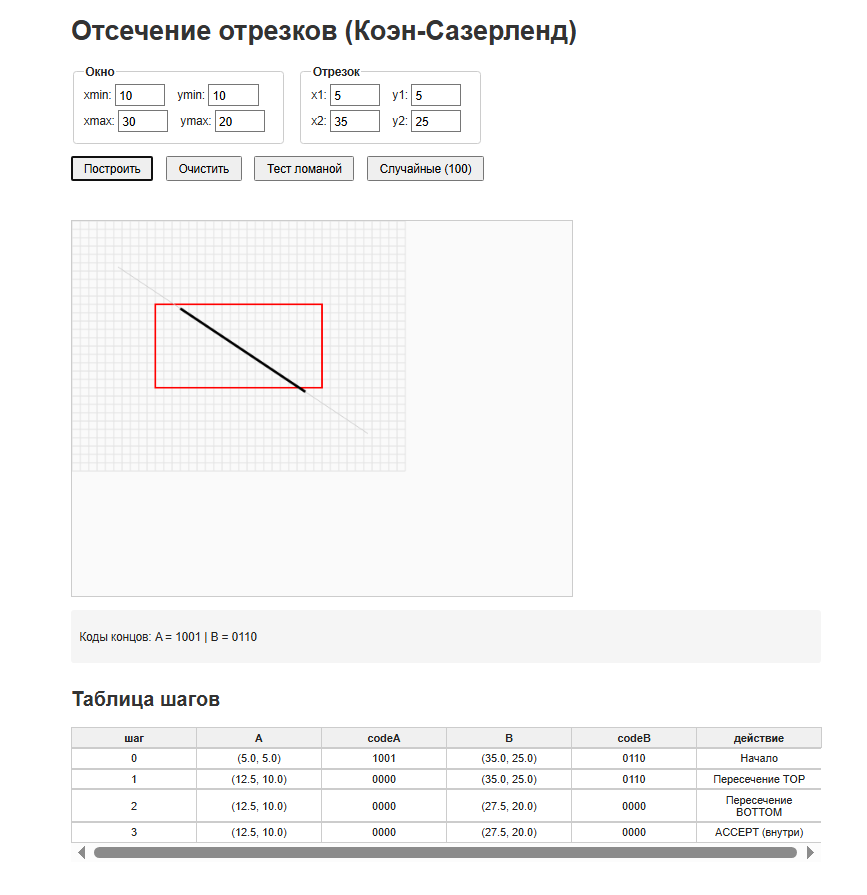

# Лабораторная работа 4. Отсечение отрезков (Коэн-Сазерленд)

## Как запустить
Открыть `index.html` в браузере. Ввести параметры окна и отрезка, нажать «Построить».

## Окно отсечения в тестах
Использовалось окно: `xmin = 10, ymin = 10, xmax = 30, ymax = 20`.

## Соглашение о четырёх битах
- `LEFT` (0001) — x < xmin
- `RIGHT` (0010) — x > xmax
- `BOTTOM` (0100) — y > ymax
- `TOP` (1000) — y < ymin
- `INSIDE` (0000) — точка внутри окна

Побитовое `|` (ИЛИ) используется для объединения кодов, `&` (И) — для поиска общих внешних областей.

## Результаты обязательных тестов
- Полностью внутри: (15, 12) -> (25, 18) — ACCEPT.
- Полностью слева: (2, 5) -> (8, 15) — REJECT.
- Пересекает одну границу: (5, 15) -> (15, 15) — отсекается до (10, 15) -> (15, 15).
- Проходит через угол: (5, 5) -> (35, 25) — отсекается с двух сторон.
- Вертикальный: (20, 5) -> (20, 25) — отсекается до (20, 10) -> (20, 20).
- Обе точки снаружи, но отрезок проходит через окно: (5, 15) -> (35, 15) — отсекается до (10, 15) -> (30, 15).

## Эксперимент со случайными отрезками
При генерации 100 случайных отрезков вокруг окна:
- Принято без изменений: ~15
- Отсечено: ~45
- Полностью отброшено: ~40

Это показывает, что большинство отрезков либо сразу отбрасываются, либо быстро обрезаются без сложных вычислений.

## Скриншот

