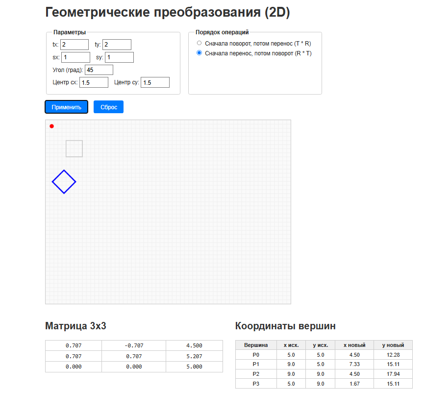

# Лабораторная работа 7. Геометрические преобразования

## Запуск
Откройте `index.html` в браузере (лучше через Live Server).

## Определения матриц
Перенос `T(tx, ty)`:
[ 1  0  tx ]
[ 0  1  ty ]
[ 0  0   1 ]

Масштаб `S(sx, sy)`:
[ sx  0  0 ]
[  0 sy  0 ]
[  0  0  1 ]

Поворот `R(θ)`:
[ cosθ -sinθ 0 ]
[ sinθ  cosθ 0 ]
[   0     0  1 ]

## Умножение матриц
Реализовано тройным циклом по формуле `C[i][j] = A[i][0]*B[0][j] + A[i][1]*B[1][j] + A[i][2]*B[2][j]`.

## Центр преобразования
По умолчанию задан центр `(10, 10)`. Для поворота и масштаба вокруг этого центра используется формула: `M = T(cx, cy) * R * S * T(-cx, -cy)`.

## Ручной расчёт
Возьмём точку P = (2, 1), угол 90°.
`cos(90)=0`, `sin(90)=1`.
`x' = 2*0 - 1*1 = -1`
`y' = 2*1 + 1*0 = 2`
Результат: `P' = (-1, 2)`.

## Результаты разных порядков
Для точки `(2, 1)`, поворота на 90° и переноса на `(3, 0)`:
1. **Сначала поворот, потом перенос (T * R):**
   `(2, 1) → (-1, 2) → (-1+3, 2+0) = (2, 2)`
2. **Сначала перенос, потом поворот (R * T):**
   `(2, 1) → (2+3, 1+0) = (5, 1) → (5*0 - 1*1, 5*1 + 1*0) = (-1, 5)`

## Почему результаты отличаются
Умножение матриц некоммутативно (A * B ≠ B * A). Поворот меняет направления осей, поэтому перенос, выполненный *после* поворота, будет идти уже в новых (повёрнутых) осях координат.

## Скриншот

