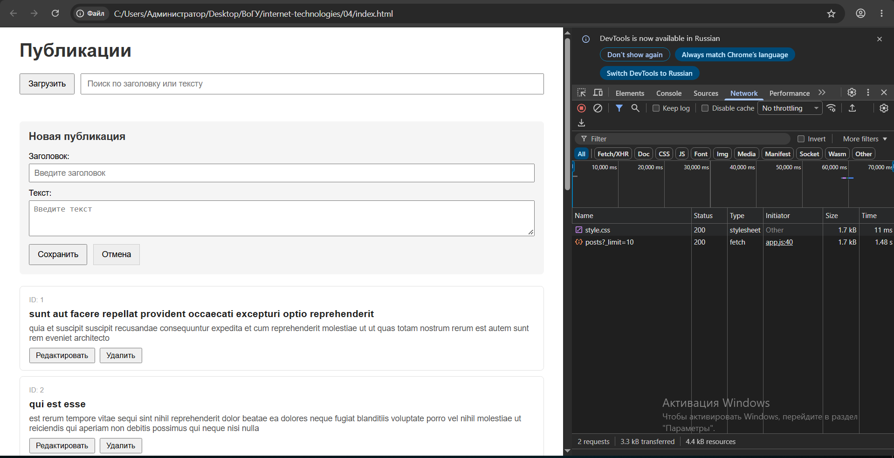
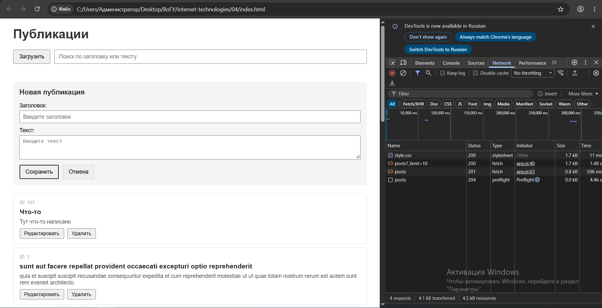
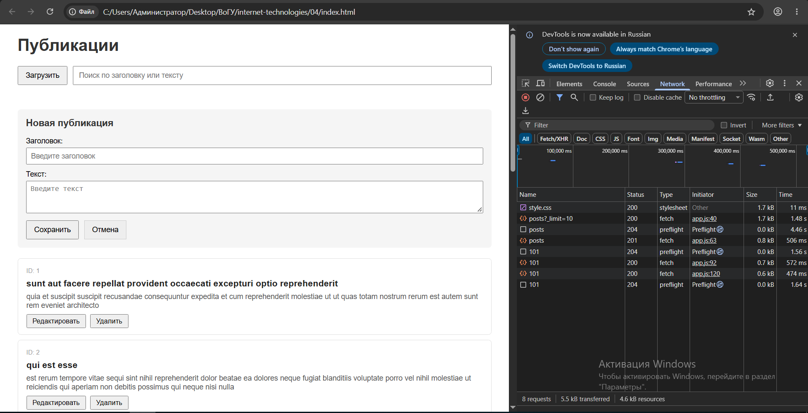

# Лабораторная работа 4. CRUD публикаций

## Как запустить
1. Открыть `index.html` через Live Server (правой кнопкой → Open with Live Server).
2. Нажать «Загрузить», чтобы получить первые 10 публикаций.

## Используемый API
`https://jsonplaceholder.typicode.com` — учебный сервис. Он принимает `GET`, `POST`, `PATCH`, `DELETE`, но не сохраняет изменения. После перезагрузки страницы всё вернётся к исходному состоянию.

## Реализованные HTTP-методы
- `GET /posts?_limit=10` — загрузка списка.
- `POST /posts` — создание новой публикации.
- `PATCH /posts/:id` — изменение существующей.
- `DELETE /posts/:id` — удаление.

## Устройство состояния
Всё хранится в одном объекте `state` в `app.js`:
- `posts` — массив публикаций;
- `isLoading` — идёт ли первоначальная загрузка;
- `isSaving` — идёт ли сохранение (POST или PATCH);
- `error` — текст ошибки;
- `editingId` — id редактируемой записи (`null` = режим создания);
- `filter` — текст поиска.

## Обработка ошибок
Каждый запрос обёрнут в `try/catch`. Дополнительно проверяется `response.ok` — если код не 200–299, бросаем ошибку вручную. Текст ошибки показывается под заголовком в `#error`. Флаги `isLoading`/`isSaving` снимаются в `finally`, чтобы интерфейс не завис.

## Что происходит после POST, PATCH, DELETE
- **POST:** дожидаемся ответа, добавляем возвращённый объект в начало `state.posts` (`unshift`), очищаем форму, вызываем `render()`.
- **PATCH:** дожидаемся ответа, заменяем нужный объект в `state.posts` через `map` и спред, очищаем форму, вызываем `render()`.
- **DELETE:** дожидаемся ответа, удаляем объект через `filter`, вызываем `render()`.

## Почему изменения исчезают после перезагрузки
JSONPlaceholder возвращает правдоподобные ответы, но **не хранит данные на сервере**. Он «подтверждает» операцию, но при следующем `GET` отдаёт тот же исходный набор. Поэтому локальное состояние обновляем сами — а после полной перезагрузки страницы оно сбрасывается.

## Скриншоты Network

