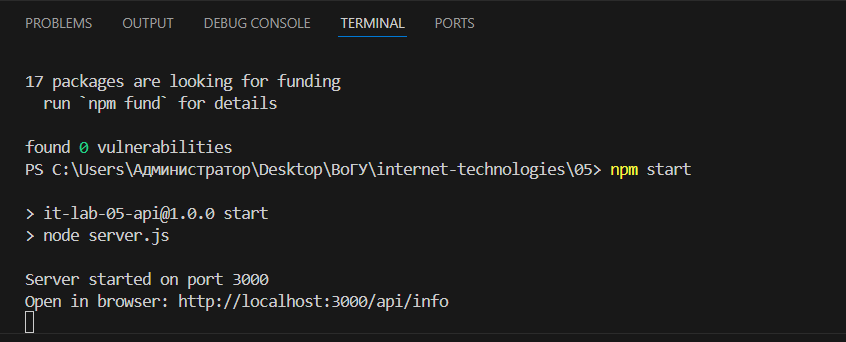
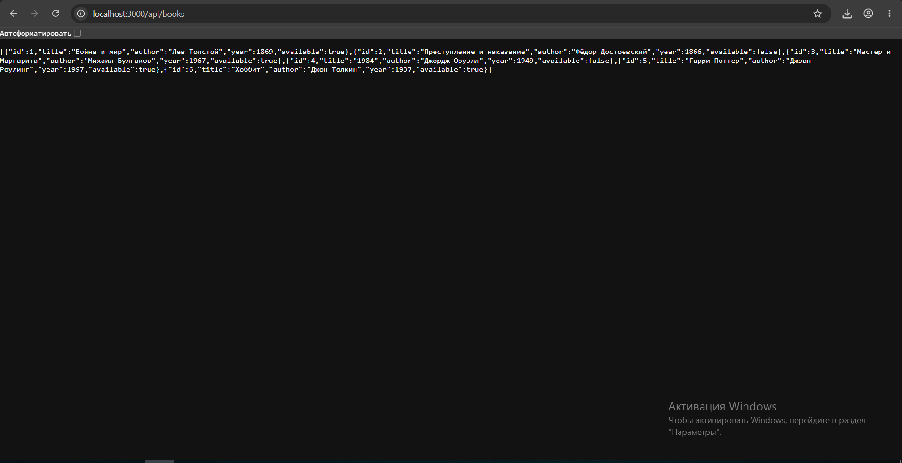

# Лабораторная работа 5. Собственный REST API

## Установка зависимостей
Перед первым запуском откройте терминал в папке `05` и выполните:
npm install

## Запуск
Выполните команду:
npm start
Сервер запустится на `http://localhost:3000`.

## Выбранная сущность
**Книги (books)**. Каждый объект имеет поля: `id`, `title`, `author`, `year`, `available`.

## Список маршрутов

| Метод | URL | Описание | Возможные статусы |
|---|---|---|---|
| GET | `/api/info` | Информация о сервере | 200 |
| GET | `/api/books` | Список всех книг (с фильтрацией) | 200 |
| GET | `/api/books/:id` | Одна книга по ID | 200, 404 |
| POST | `/api/books` | Создать новую книгу | 201, 400 |
| ANY | `*` | Неизвестный маршрут | 404 |

## Примеры Query-параметров
- `GET /api/books?author=Толстой` — книги Толстого.
- `GET /api/books?available=true` — только доступные книги.
- `GET /api/books?q=война` — поиск по слову в названии.
Можно комбинировать: `GET /api/books?available=true&q=мастер`.

## Примеры запросов

### Корректный POST (создание)
Отправка запроса:
curl -X POST http://localhost:3000/api/books -H "Content-Type: application/json" -d "{\"title\": \"Новая книга\", \"author\": \"Автор\", \"year\": 2024}"

Ответ: статус `201 Created`, JSON с новой книгой.

### Ошибочный POST (без обязательного поля)
Отправка запроса:
curl -X POST http://localhost:3000/api/books -H "Content-Type: application/json" -d "{\"title\": \"Книга без автора\"}"

Ответ: статус `400 Bad Request`, JSON: `{"error": "title and author are required"}`.

### Несуществующий маршрут
Отправка запроса:
curl http://localhost:3000/api/does-not-exist

Ответ: статус `404 Not Found`, JSON: `{"error": "Route not found"}`.

## Скриншоты работы

**Запуск сервера в терминале:**

**Ответ API со списком книг:**

