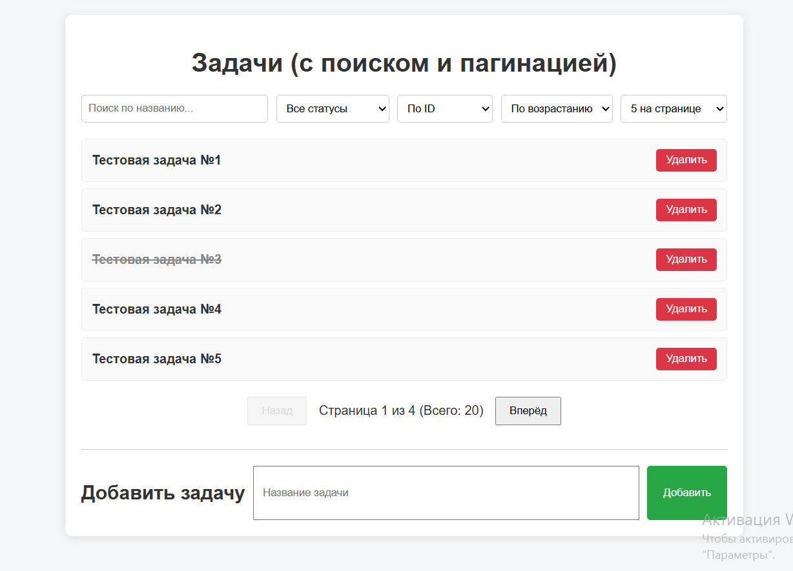
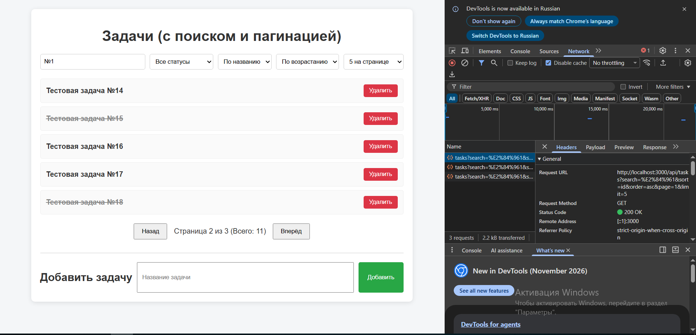
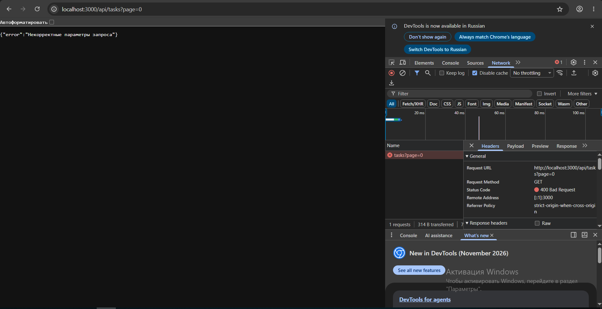

# Лабораторная работа 8. Поиск, сортировка и пагинация

## Запуск
1. npm install
2. node seed.js (заполнит базу 20 задачами для теста)
3. npm start
4. Откройте http://localhost:3000

## Структура
- server.js — Express-сервер с API.
- seed.js — скрипт для генерации тестовых данных.
- public/ — клиентская часть (HTML/CSS/JS).

## Таблица параметров API
Маршрут: GET /api/tasks

| Параметр | Допустимые значения | По умолчанию |
| :--- | :--- | :--- |
| page | Целое число >= 1 | 1 |
| limit | Целое число от 1 до 50 | 5 |
| done | true или false | (без фильтра) |
| search | Строка до 100 символов | (пусто) |
| sort | id, title, done | id |
| order | asc, desc | asc |

## Пример JSON-ответа с пагинацией
В ответ сервер возвращает не просто массив, а объект с элементами и метаданными.
items: массив задач (id, title, done и т.д.)
pagination: объект, содержащий page (текущая страница), limit (сколько на странице), total (всего подходящих записей) и pages (общее количество страниц).

## SQL-примеры
- WHERE (поиск): SELECT * FROM tasks WHERE title LIKE '%Тест%'
- ORDER BY (сортировка): ORDER BY id DESC
- LIMIT/OFFSET (пагинация): LIMIT 5 OFFSET 5 (вторая страница)

## Защита от SQL-инъекций
Имена полей для сортировки берутся из белого списка (объекта sortColumns). Пользовательский ввод не попадает напрямую в SQL для ORDER BY. Значения для WHERE и LIMIT передаются через параметризованные запросы (знак вопроса).

## Серверная фильтрация
Серверная фильтрация загружает только нужные данные из базы (через SQL). Клиентская (через array.filter) загружает всё в память браузера, что неэффективно при большом объеме данных.

## Визуализация и проверка

**Интерфейс с пагинацией:**

**Запросы в Network (поиск, сортировка, пагинация):**

**Ошибка 400 при некорректном параметре:**
