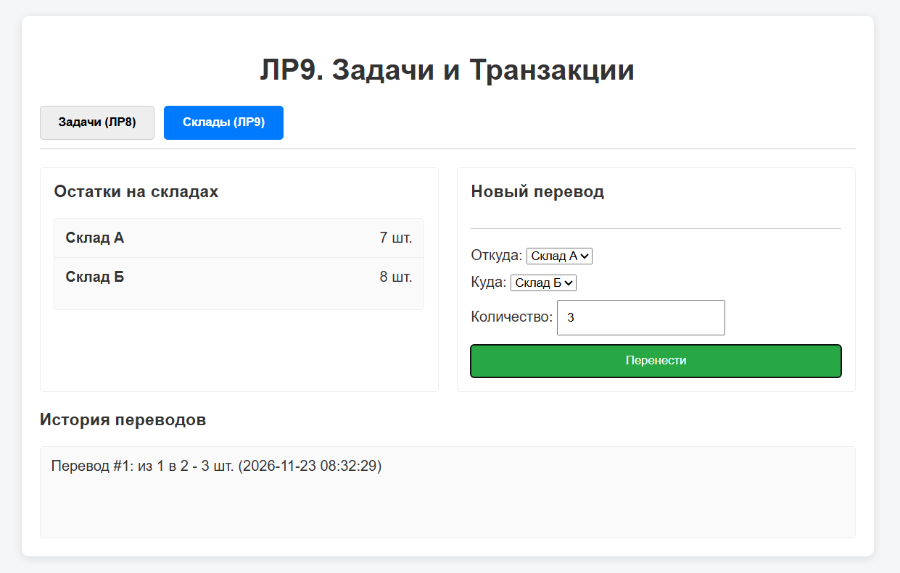
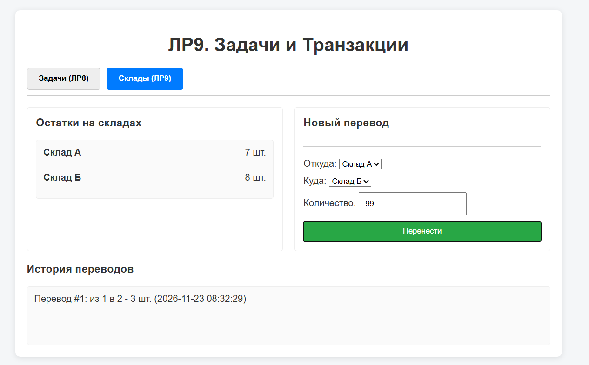
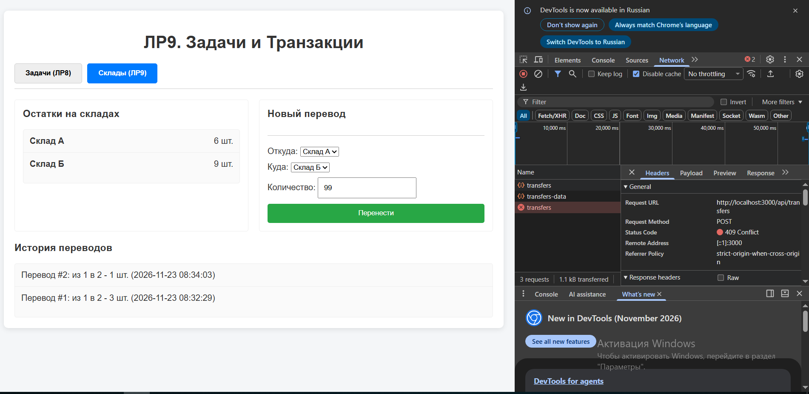
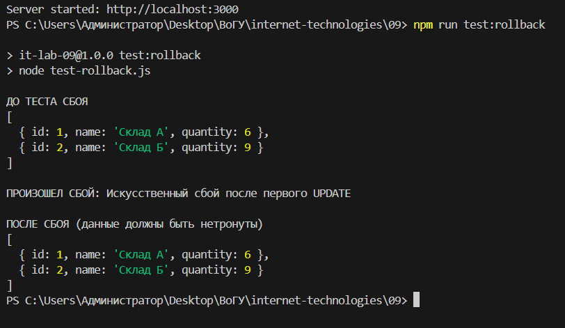

# Лабораторная работа 9. Транзакции SQLite

## 1. Бизнес-операция
В качестве операции выбран перенос количества товара между складами. Операция требует нескольких SQL-запросов: уменьшение остатка на складе-источнике, увеличение остатка на складе-получателе и запись факта перевода в журнал. Без транзакции сбой после первого шага привел бы к потере товара и нарушению целостности данных.

## 2. Схема таблиц и ограничения
**inventories (Склады)**
- id (PRIMARY KEY)
- name (NOT NULL UNIQUE)
- quantity (INTEGER NOT NULL CHECK >= 0)

**transfers (История переводов)**
- id (PRIMARY KEY)
- from_id (FOREIGN KEY на inventories)
- to_id (FOREIGN KEY на inventories)
- quantity (CHECK > 0)
- created_at (DEFAULT CURRENT_TIMESTAMP)
- Дополнительное ограничение: CHECK(from_id <> to_id) запрещает перевод самому себе.
- Включена проверка внешних ключей: db.pragma('foreign_keys = ON').

## 3. Инварианты
1. Остатки на складах не могут быть отрицательными (quantity >= 0).
2. Суммарное количество товара на всех складах остается неизменным.
3. Запись в историю transfers появляется тогда и только тогда, когда остатки успешно изменены.

## 4. Границы транзакции
Используется db.transaction() из библиотеки better-sqlite3. Внутри функции выполняются три запроса. Если любой из них завершается ошибкой (например, не хватает остатка), выбрасывается исключение. Библиотека перехватывает его и делает ROLLBACK. В случае успешного выполнения всех запросов — COMMIT.

## 5. HTTP-маршрут и примеры
**Успех:** POST /api/transfers с { "fromId": 1, "toId": 2, "quantity": 3 } возвращает 201 Created.
**Нехватка остатка:** POST /api/transfers с { "fromId": 1, "toId": 2, "quantity": 99 } возвращает 409 Conflict.
**Несуществующий ID:** POST /api/transfers с { "fromId": 1, "toId": 999, "quantity": 1 } возвращает 404 Not Found.
**Некорректные данные:** POST /api/transfers с одинаковыми ID или отрицательным числом возвращает 400 Bad Request.

## 6. Доказательство rollback
Для демонстрации отката запускается скрипт npm run test:rollback. Скрипт оборачивает два UPDATE в транзакцию и после первого выбрасывает искусственное исключение.

Вывод терминала:
ДО ТЕСТА СБОЯ
[
  { id: 1, name: 'Склад А', quantity: 6 },
  { id: 2, name: 'Склад Б', quantity: 9 }
]

ПРОИЗОШЕЛ СБОЙ: Искусственный сбой после первого UPDATE

ПОСЛЕ СБОЯ (данные должны быть нетронуты)
[
  { id: 1, name: 'Склад А', quantity: 6 },
  { id: 2, name: 'Склад Б', quantity: 9 }
]

Данные до и после сбоя идентичны, что подтверждает корректную работу ROLLBACK.

## 7. Сохранение после перезапуска
Данные хранятся в файле data.db. После остановки сервера (Ctrl+C) и повторного запуска команды npm start остатки на складах и история переводов сохраняются в том же состоянии, в котором они были до выключения.

## 8. Скриншоты
**Успешная операция:**

**Ошибка нехватки остатка (409):**

**Запросы во вкладке Network:**

**Проверка rollback в терминале:**

## 9. Пояснение валидации
1. **В браузере (HTML):** атрибут min="1" не дает ввести отрицательное число в форму, но легко обходится через отправку запроса напрямую.
2. **В Express:** функция isPositiveInteger строго отсекает строки, NaN, отрицательные числа и одинаковые ID, возвращая код 400.
3. **В SQLite:** ограничения CHECK (quantity >= 0) и внешние ключи FOREIGN KEY — это последняя линия обороны базы данных, гарантирующая целостность даже при ошибке на сервере.