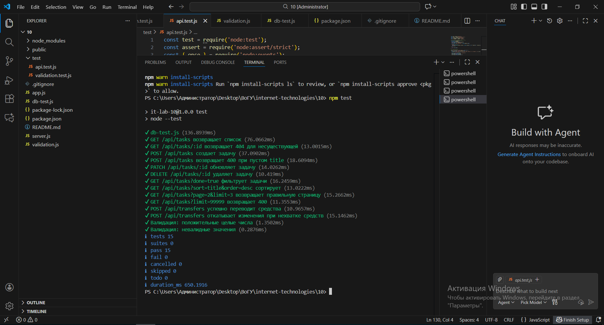
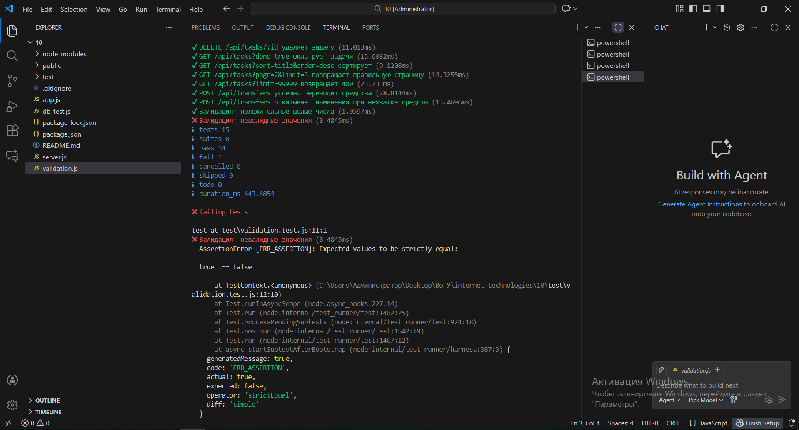

# Лабораторная работа 10. Автоматические тесты Express API и SQLite

## Запуск
1. Установите зависимости: `npm install`
2. Запустите сервер: `npm start`
3. Запустите тесты: `npm test`

Версия Node.js: v20.11.0 (встроенные `node:test` и `fetch` требуют Node.js >= 18).

## Структура проекта
- `app.js` — фабрика приложения `createApp(db)`, содержит все маршруты.
- `server.js` — точка входа, инициализирует рабочую базу и запускает `app.listen()`.
- `validation.js` — модуль с функциями валидации.
- `db-test.js` — фабрика `createDb()` для создания изолированной тестовой базы SQLite в памяти.
- `test/api.test.js` — 12 интеграционных тестов для HTTP-маршрутов.
- `test/validation.test.js` — модульные тесты валидации.

## Изоляция базы данных
Тесты не используют рабочую базу `data.db`. Каждый тест вызывает `createDb()`, которая создает новую базу в `:memory:`. Это гарантирует, что тесты не зависят друг от друга и не изменяют реальные данные.

## Разделение app и server
Разделение выполнено для того, чтобы тесты могли импортировать `createApp(db)` и передать туда тестовую базу, не запуская реальный сервер на порту 3000. `server.js` отвечает только за запуск и инициализацию рабочей базы.

## Список тестов и ожидаемых результатов
1. **GET /api/tasks** — 200, список задач.
2. **GET /api/tasks/:id** (несуществующий) — 404.
3. **POST /api/tasks** (успех) — 201, задача создана.
4. **POST /api/tasks** (пустой title) — 400.
5. **PATCH /api/tasks/:id** (успех) — 200, задача обновлена.
6. **DELETE /api/tasks/:id** — 204, задача удалена.
7. **Фильтрация** `?done=true` — только выполненные.
8. **Сортировка** `?sort=title&order=desc` — правильный порядок.
9. **Пагинация** `?page=2&limit=3` — правильные `total` и `pages`.
10. **Невалидный query** `?limit=99999` — 400.
11. **Успешная транзакция** — остатки изменились (A: 7, B: 8).
12. **Сбой транзакции** — 409, остатки не изменились (A: 10, B: 5).

## Скриншоты
**Успешный запуск тестов:**

**Намеренно проваленный тест (демонстрация):**

## Доказательство rollback
В тесте №12 проверяется, что при попытке перевести 99 единиц из склада с остатком 10 возникает ошибка 409. После этого тест читает данные из SQLite и проверяет, что остатки не изменились, а журнал `transfers` остался пустым. Это доказывает, что транзакция полностью откатилась.